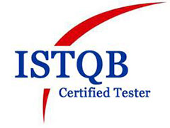
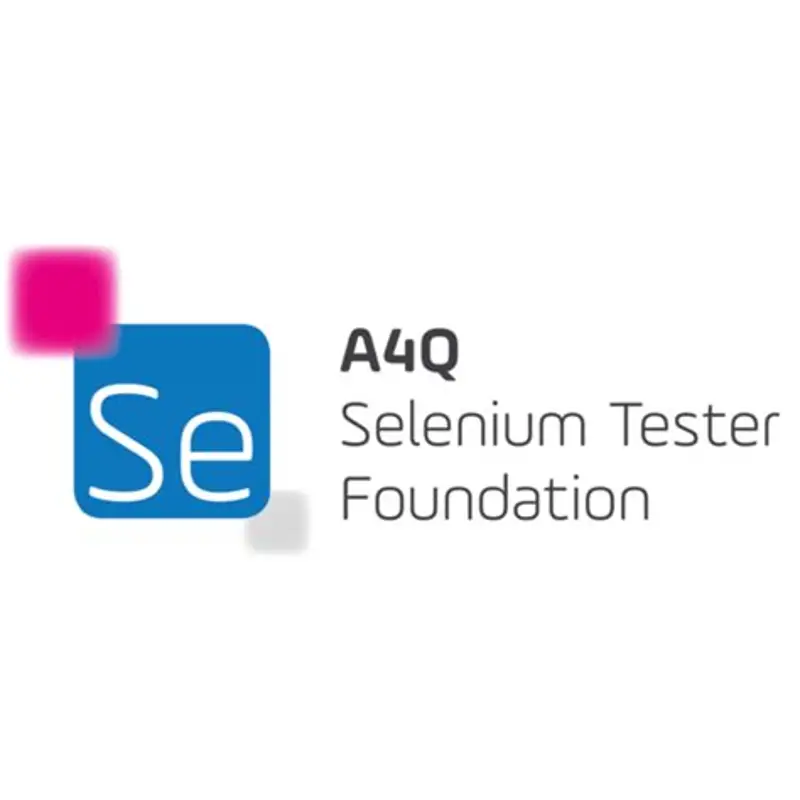
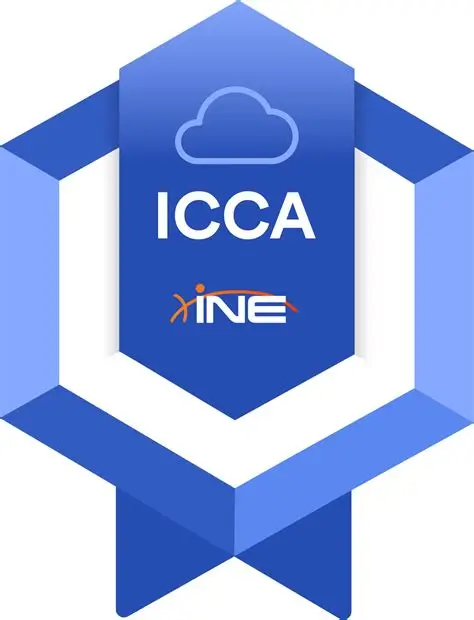
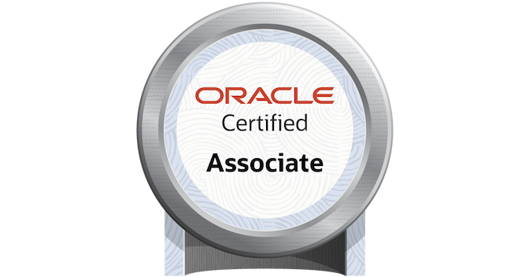

<!-- ============================================================
  GITHUB PROFILE README
  Repository: PUBLIC, named exactly like your username -> Arbia-riahi
  Put these files at the ROOT of the repository (no sub-folder):
    README.md, A4Q.webp, istqb-ct-genai.png, ine-icca.png, oracle-oca.png
  Replace every <placeholder> before publishing.
============================================================= -->

<!-- CERTIFICATION LOGOS
     Grid of 5 columns x 2 rows, same height for every logo, name under each logo.
     Credly badges are loaded from images.credly.com.
     ISTQB CT-GenAI, A4Q, INE and Oracle logos are stored at the root of this repo.
-->
<table align="center">
  <tr>
    <td align="center" width="150">
       
      <b>ISTQB CTFL v4.0</b>
    </td>
    <td align="center" width="150">
       
      <b>ISTQB CT-GenAI</b>
    </td>
    <td align="center" width="150">
       
      <b>A4Q Selenium Tester</b>
    </td>
    <td align="center" width="150">
       
      <b>Scrum Master I</b>
    </td>
    <td align="center" width="150">
       
      <b>Product Owner I</b>
    </td>
  </tr>
  <tr>
    <td align="center" width="150">
       
      <b>AWS AI Practitioner</b>
    </td>
    <td align="center" width="150">
       
      <b>AWS Cloud Practitioner</b>
    </td>
    <td align="center" width="150">
       
      <b>PCAP Python</b>
    </td>
    <td align="center" width="150">
       
      <b>INE Cloud Associate</b>
    </td>
    <td align="center" width="150">
       
      <b>Oracle Java SE 8</b>
    </td>
  </tr>
</table>

### I help teams ship reliable software, faster.
**Automated testing · Full-stack development · AI agent testing**

-1F4E79)

[LinkedIn](https://linkedin.com/in/riahi-arbia-9b3368267) ·
[Email](mailto:riahiarbia840@gmail.com) ·
[Upwork](<your-upwork-url>) ·
[Portfolio](<your-portfolio-url>)

---

## 👋 About Me

I am a **QA Automation Engineer and Full-Stack Developer** with **2+ years of experience**, based in Tunisia and working remotely with international teams.

I combine two points of view that rarely come together:

- **As a developer**, I build web applications with Angular, Express.js, Spring Boot, and modern databases.
- **As a QA engineer**, I know exactly where software breaks, and I build automation that catches problems before your users do.

The result: **fewer bugs in production, faster releases, and less manual testing effort.** On my projects, test automation reduced manual regression effort by **40%**.

I am also one of the few engineers who **tests AI agents and LLM-based applications**: tool calling, reasoning consistency, robustness, and hallucination detection.

---

## 🚀 How I Can Help You

| Service | What you get |
|---|---|
| **Test Automation (UI, API, Mobile)** | Reliable, maintainable automated tests with Selenium, Playwright, Appium, REST Assured, Cucumber, and TestNG / JUnit |
| **Regression Testing Automation** | Reduce repetitive manual testing and release with confidence |
| **QA Strategy and Test Design** | Test plans, test cases, acceptance criteria, traceability matrix, BDD with Gherkin |
| **CI/CD Quality Pipelines** | Automated tests, code quality (SonarQube), and security scans (Snyk) in GitHub Actions, GitLab, or Jenkins |
| **API Testing** | Functional and integration tests with Postman and REST Assured |
| **Performance Testing** | Load and response-time tests with JMeter |
| **AI Agent and LLM Testing** | Reference datasets, tool calling checks, robustness tests, hallucination detection |
| **Full-Stack Web Development** | Angular front end, Express.js or Spring Boot back end, SQL and NoSQL databases |
| **Data Pipelines and Data Quality** | Python ETL, data validation, and ML model monitoring (metrics and drift detection) |

---

## 💡 Why Work With Me?

- **Proven impact**: -40% manual regression effort through automation.
- **Both sides of the code**: I understand development and testing, so communication is fast and feedback is useful.
- **Certified**: ISTQB CTFL v4.0, ISTQB CT-GenAI, PSM I, PSPO I, AWS, Oracle, Python Institute, and more.
- **Agile by default**: Scrum certified, comfortable in sprints, ceremonies, and fast feedback loops.
- **Clear reporting**: execution reports, defect tracking, and traceability from requirement to test.
- **Remote-ready**: experience working with a New York-based company in a fully remote setup.

---

## 🛠️ Tech Stack

### Test Automation

### CI/CD and Code Quality

### Test Management

### Development

### Databases

### AI and Cloud

### Tools

---

## 🎓 Certifications

| Certification | Issuer |
|---|---|
| ISTQB® Certified Tester Foundation Level (CTFL) v4.0 | ISTQB |
| ISTQB® Certified Tester Testing with Generative AI (CT-GenAI) | ISTQB |
| A4Q Certified Selenium Tester (CST) | A4Q |
| Professional Scrum Master™ I (PSM I) | Scrum.org |
| Professional Scrum Product Owner™ I (PSPO I) | Scrum.org |
| AWS Certified AI Practitioner (AIF) | Amazon Web Services |
| AWS Certified Cloud Practitioner (CCP) | Amazon Web Services |
| INE Certified Cloud Associate (ICCA) | INE |
| Oracle Certified Associate, Java SE 8 Programmer | Oracle |
| Certified Associate Python Programmer (PCAP-31-03) | Python Institute |

---

## 🎓 Education

- **Engineering Degree in Software Engineering**, Tek-Up University, Tunis (2023 – 2026)
- **Bachelor's Degree in Computer Science**, ISIG Kairouan (2020 – 2023)

---

## 🤝 How I Work

1. **Understand**: I start with your product, your risks, and your goals.
2. **Plan**: test strategy, scope, priorities, and clear acceptance criteria.
3. **Build**: maintainable automation and clean code, integrated into your CI/CD.
4. **Report**: clear results, tracked defects, and full traceability.
5. **Improve**: I keep reducing flaky tests, maintenance effort, and release risk.

---

## 📊 GitHub Stats

---

## 📬 Let's Work Together

Do you need to automate your tests, secure your releases, test an AI feature, or build a web application?

**Tell me about your project, and I will reply with a clear plan.**

---

*Quality is not an afterthought. It is built in from the first line.*

